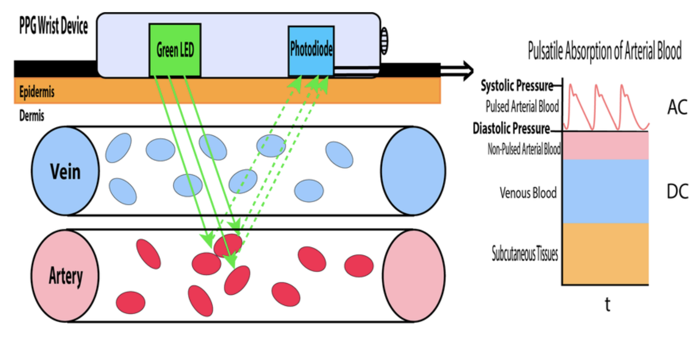

- [Your lack of commitment is insult to those who believe in you](https://secret2anamazinglife.com/2024/04/23/stop-insulting-those-who-believe-in-you-%F0%9F%9B%91/)

- I went to KU hackfest 2025. Since the project has been concluded, i wish there was a project showcase site so i could skim through more projects. But here are some of my favorites
  - **Fallacy Detection**: Fallacy is a applying incorrect reasoning to argument. When looking at [list of fallacies](https://en.wikipedia.org/wiki/List_of_fallacies) there are formal and informal fallacies. Formal fallacies are those which has flaw in it's logical structure. Informal fallacies require extra context and content which means there is no propositional, predicative or modal logic that can model these fallacies. These require different [argument schemes](https://en.wikipedia.org/wiki/Argumentation_scheme). These schemes answer the question on how to model something that is correct when it's syntactically correct, logically sound and valid but might be wrong with more context. *Reasonable unless defeated* stuff. This is done by replacing the proposition's truth table with constraints over structured objects. This is such a cool thing to look into, and i can imagine this never being accurate and detecting in histograms. But good idea none the less
  - **Sound source localization for Beam Forming**: Imagine you have several microphones arranged in a circle. When someone speaks, the sound reaches the microphones at slightly different times. This difference is time allows us to get the direction. It's all simple maths basically. Once you know that direction, you can line up the recordings by shifting microphone's audio forward or backward by exactly the amount needed so that the desired speaker's voice peaks happen at the same moment in all recordings. Then when you add the signals together. The wanted voice adds up cleanly and gets louder/clearer because all the copies now match in time. This is constructive interference. But sounds coming from other directions don't match and we get destructive interference.
  - **PPG Authentication system**: Damn how could i forget about this one? A biometric system like fingerprint but using device camera and flashlight. It uses the same mechanism as these SpO2 devices. It's called photoplethysmography which is used to detect blood volume changes in bed of tissue. Done by illuminating the skin with the light from a (LED) and then measuring the amount of light either transmitted or reflected to a photodiode . They were creating a fkin authentication system around that. Initially i was blown away because i had no idea that this signal is unique to each individual but there are various places of drift : the area people will expose like hand, face or the drift that comes with aging, time of the day [et cetera ad nauseam](https://www.accelerateenglish.com/post/23-latin-phrases-we-still-use-in-english).

  <figure>
  
  <figcaption
  aria-hidden="true">Pastedimage20251230174042.png</figcaption>
  </figure>

- [Biodeterminism](https://slatestarcodex.com/2014/02/18/proposed-biological-explanations-for-historical-trends-in-crime/) is about how biological factors influence and matter more social systems rather than the social influence itself. For example, ["Lead poisioning"](https://www.youtube.com/watch?v=IV3dnLzthDA) caused crime rates to be increased 4x times in US. Omega-3 fatty acids in diet supplement caused Australian prison to see 25% decrement in crime.
  Social influences are everywhere. From advertisements, micro engagement platforms created by [fentanyl zombies](https://www.lesswrong.com/posts/JH6tJhYpnoCfFqAct/the-company-man?ref=feedle.world), religion, environment and upbringing all can be held up as a social influence. Well i can see how someone with big spleen can dive longer because of having more oxygen reserve which seems to be genetic thing, but i don't see how we can ever trace everything to biological effects.

- Among my college circle, we had the first one to leave this place for pursuing (masters)better life. He was among the select few who used to see future in Nepal. Maybe, the very act of trying to realize his dreams within these bounds exhausted him.
  He is the one "Destined to be great or destined to fail who is living in this dichotomy". I had to gift him "Antifragile" by Taleb to remind that [Destiny isn't written, it's claimed](https://en.wikipedia.org/wiki/Antifragile_(book))
  > To move on to becoming antifragile then requires a combination of low fixed obligations with making small bets that have asymmetric payoffs.

  I wish him all the best for his endeavours. His success increases my luck surface area.

- [A complaint should have good reason for existing](https://outerproduct.net/trivial/2024-03-25_complain.html). The blog aptly named "How to complain" can be made better by introduction of [E-prime](https://en.wikipedia.org/wiki/E-Prime) language which avoids all the to-be verbs. Quoting from [sled perf](https://sled.rs/perf.html)
  \> Don't say "lock-free queues are faster than mutex-backed queues", say "on hardware H with T threads running in tight loops performing operations O, our specific lock-free queue has been measured to achieve a latency distribution of X1 and our specific mutex-backed queue has been measured to achieve a latency distribution of X2." It's likely your lock-free queue will sometimes perform worse than a well-made mutex-backed queue given certain hardware, contention and many other factors. What does "perform worse" even mean?

- [nat.org](https://nat.org/) says "Going fast makes you focus on what's important; there's no time for bullshit" or the best one which says "- A week is 2% of the year"

- Two things i want to consolidate for 2026 is that
  - I got to close the gap of feedback loop. Seek ideas that are easy to test and get results from so iteration is rapid. That means breaking things fast.
  - This means going for a niche stuff is the way

- [Performative Reading](https://www.newyorker.com/culture/the-lede/performative-reading) is the new way of showing you are much more than the brain rot by picking up books purely for looking sophisticated and increasing coital opportunities . Hahahah. I do that too

- [The right idea could start out life as the wrong idea](https://signalvnoise.com/posts/3124-give-it-five-minutes)

- TIL [Tu Quoque](https://en.wikipedia.org/wiki/Tu_quoque) or "you-too" informal fallacy or "You say smoking is bad, but you smoke---so smoking isn't bad."

- [The most successful people are brutally selective about their inputs](https://kupajo.com/beware-of-black-butterflies/)

- [Engineering at google](https://abseil.io/resources/swe-book/html/toc.html) This seems like a good book to look at.

- [Plans are worthless, but planning is everything](https://abseil.io/fast/72)
